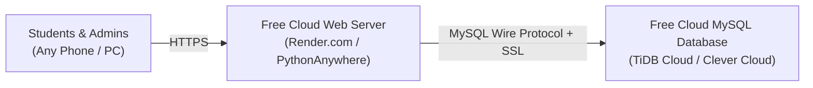
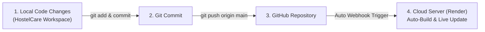

# 🌐 Free Cloud Deployment Guide for HostelCare
### 100% Free Forever • Zero Subscription • No Credit Card Required

This guide walks you through deploying both the **HostelCare website** and the **MySQL database** to the cloud so anyone can access it from any phone, laptop, or computer anywhere in the world.

---

## 🏗️ Architecture Overview



---

## 🗄️ PART 1: Host the MySQL Database in the Cloud (Free Forever)

### Recommended: **TiDB Cloud (Serverless)**
* **Cost**: **$0 / month forever** (Free tier provides 5 GB storage).
* **Credit Card**: **NONE required** (Sign up with GitHub or Google).
* **Compatibility**: 100% MySQL 8.0 wire-compatible (works seamlessly with our `pymysql` driver).

#### Step-by-Step Setup (Takes 2 minutes):
1. Go to **[https://tidbcloud.com](https://tidbcloud.com)** and click **"Start Free"**.
2. Sign in with your **Google** or **GitHub** account.
3. Under clusters, click **"Create Cluster"** and choose **"Serverless"** ($0/month).
4. Give it a name (e.g. `hostelcare-db`) and click **"Create"**.
5. Once created, click the **"Connect"** button in the dashboard:
   - Select **Connection Method**: *General* or *PyMySQL*.
   - Click **"Allow access from anywhere"** (`0.0.0.0/0`) so cloud servers can connect.
   - Note down the generated:
     - **Host**: e.g., `gateway01.us-east-1.prod.aws.tidbcloud.com`
     - **Port**: `4000`
     - **User**: e.g., `2AbcDef.root`
     - **Password**: Your generated cluster password
     - **Database**: `hostelcare`
   - Or copy the complete **Connection URL**:
     ```
     mysql://<USER>:<PASSWORD>@<HOST>:4000/hostelcare?ssl_verify_cert=true
     ```
6. Click the built-in **"SQL Editor"** tab on TiDB Cloud, paste the contents of [schema.sql](file:///d:/vscodee/hostel/schema.sql), and click **Run**.
   *(Your database is now fully populated in the cloud with users, tickets, and email history!)*

---

## 🚀 PART 2: Host the Website on a Free Cloud Server

### Recommended: **Render.com**
* **Cost**: **$0 / month forever** (Free tier web services).
* **Credit Card**: **NONE required**.
* **Features**: Automatic deployment, custom subdomain, free automatic HTTPS/SSL certificate.

#### Step 1: Push Your Code to GitHub
Open your terminal in `d:\vscodee\hostel` and run:
```bash
# 1. Rename branch to main
git branch -M main

# 2. Link to your personal GitHub repository (create an empty repo on GitHub first named 'hostelcare')
git remote add origin https://github.com/<YOUR_GITHUB_USERNAME>/hostelcare.git

# 3. Push code
git push -u origin main
```

#### Step 2: Deploy on Render
1. Go to **[https://render.com](https://render.com)** and sign in with **GitHub** (Free).
2. Click **"New +"** in the top navigation and select **"Web Service"**.
3. Select your **`hostelcare`** repository from the list.
4. Render will auto-fill settings using our included [render.yaml](file:///d:/vscodee/hostel/render.yaml) & [Procfile](file:///d:/vscodee/hostel/Procfile):
   - **Environment**: `Python`
   - **Build Command**: `pip install -r requirements.txt`
   - **Start Command**: `python server.py`
   - **Instance Type**: **Free**
5. Scroll down to **"Environment Variables"** and add:
   - **`DATABASE_URL`**: Your cloud connection string from Part 1:
     `mysql://<USER>:<PASSWORD>@<HOST>:4000/hostelcare?ssl_verify_cert=true`
   - *(Optional for Live Real Emails)*:
     - **`SMTP_HOST`**: `smtp.gmail.com` (or `smtp-relay.brevo.com`)
     - **`SMTP_PORT`**: `587`
     - **`SMTP_USER`**: Your Gmail / Brevo address (e.g. `hostelwarden@gmail.com`)
     - **`SMTP_PASSWORD`**: Your 16-character [Google App Password](https://myaccount.google.com/apppasswords)
     - **`SMTP_FROM_NAME`**: `HostelCare Administration`
6. Click **"Deploy Web Service"**.
7. In about 60 seconds, your site will be live at:
   👉 **`https://hostelcare.onrender.com`** *(or your chosen custom service name)*.

---

## 🔄 PART 3: How to Reflect Modifications in Git & Cloud Deployment

Whenever you make any changes to your code, follow this simple 3-step workflow to push your updates so your cloud server redeploys automatically:



### 1. Check your modified files:
```powershell
git status
```

### 2. Stage and commit your changes:
```powershell
git add .
git commit -m "feat: real email sent to resident when hostel issue is sorted out"
```

### 3. Push to GitHub:
```powershell
git push origin main
```

### 4. Automatic Cloud Redeployment:
- If you have connected your GitHub repository to **Render** (or Koyeb/Vercel):
  - Render will **automatically detect the new commit** on the `main` branch.
  - It triggers a fresh build (`pip install -r requirements.txt`) and restarts `python server.py`.
  - Your updated live website is refreshed in **under 60 seconds with zero downtime**!
- You can watch the live build progress anytime in your **Render Dashboard ➔ Events / Logs**.

## 💡 ALTERNATIVE OPTION: All-in-One on **PythonAnywhere**
If you prefer having both the **Python Web Server** and the **MySQL Database** inside a single platform:
1. Go to **[https://www.pythonanywhere.com](https://www.pythonanywhere.com)** and create a **Free Beginner account** (no credit card).
2. Go to the **Databases** tab:
   - Set a MySQL root password.
   - Click **"Initialize MySQL"**.
   - Your database host is `<yourusername>.mysql.pythonanywhere-services.com`.
3. Open a **Bash Console** on PythonAnywhere and clone your repo:
   ```bash
   git clone https://github.com/<YOUR_GITHUB_USERNAME>/hostelcare.git
   cd hostelcare
   pip install --user -r requirements.txt
   mysql -u <yourusername> -p -h <yourusername>.mysql.pythonanywhere-services.com <yourusername>$hostelcare < schema.sql
   ```
4. In the **Web** tab, configure a new web app pointing to `server.py` or WSGI.
5. Your site is live at: `https://<yourusername>.pythonanywhere.com`.

---

## 📱 Testing from Any System
Once deployed:
1. Open the URL on **any mobile browser (Safari / Chrome)**, Android, iOS, Windows, Mac, or Linux.
2. Sign in using the student or admin credentials:
   - **Student Demo**: `21BCE1042@at` / `password123`
   - **Admin Demo**: `admin@hostel.edu` / `admin123`
3. Try submitting a new issue or changing issue progress — all data updates in real-time in your cloud MySQL database!
